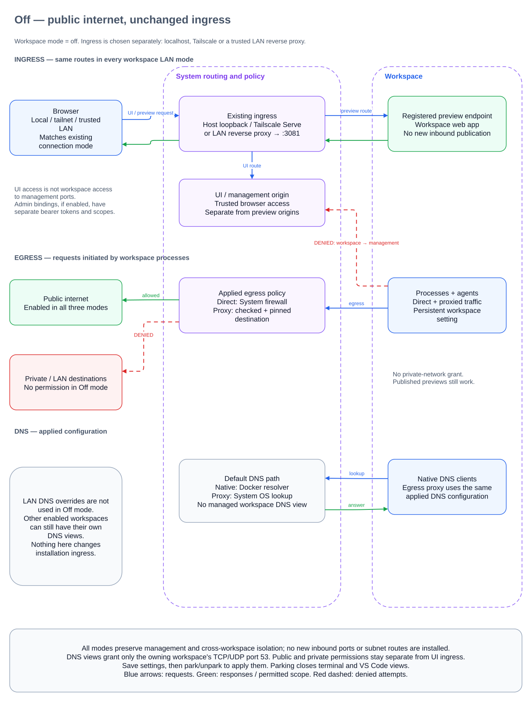
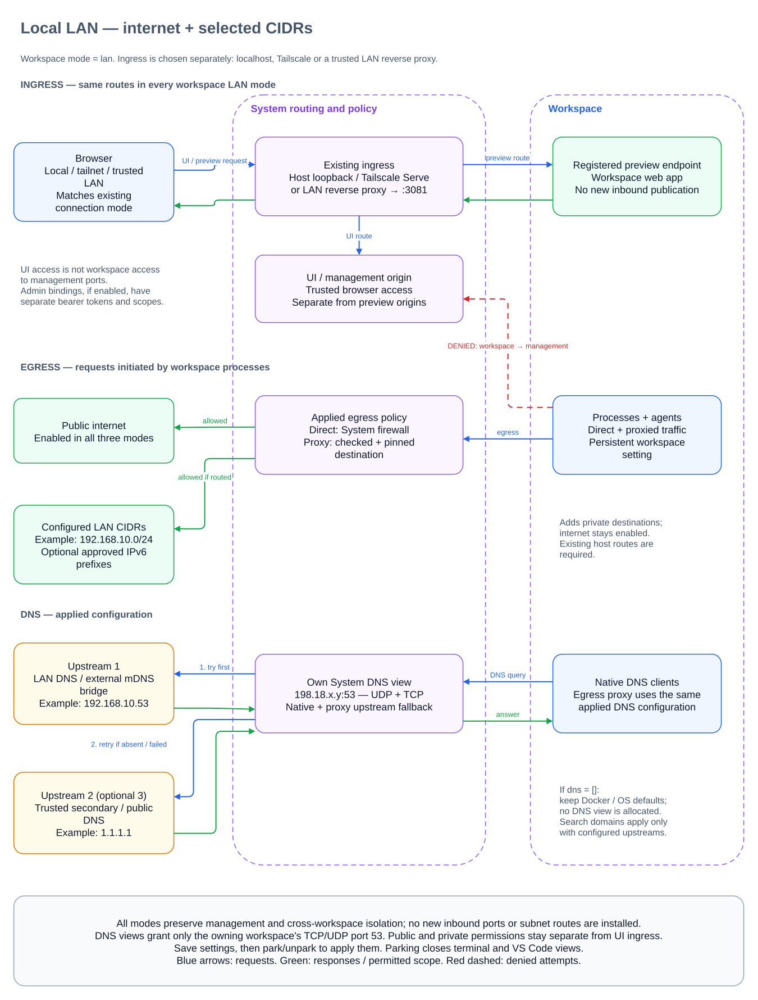
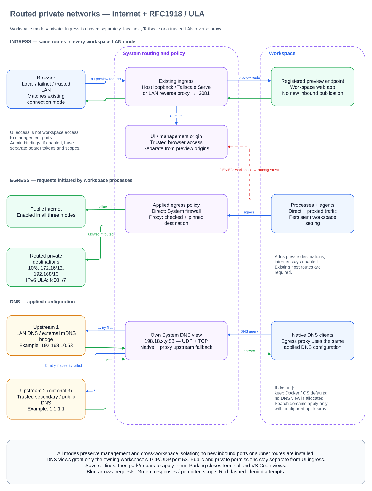
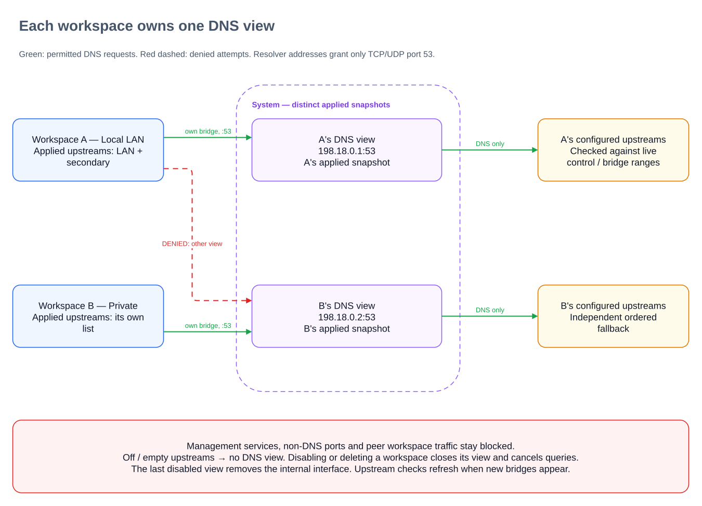
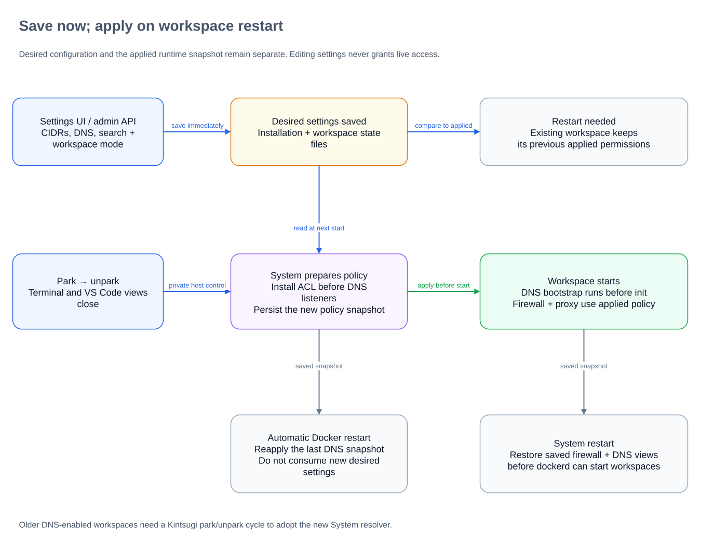

# Workspace network policy

Workspace LAN access is a persistent, opt-in egress permission. It defaults to `off`, requires System for runtime enforcement, and applies to every process and agent in the workspace. It is independent of UI/admin listener exposure and Tailscale subnet-route acceptance. System runs an opt-in, workspace-only DNS forwarding service; an external bridge still handles mDNS. No LAN or Tailscale subnet routes are installed.

## Modes and configuration

| Mode | Additional destinations |
| --- | --- |
| `off` | None; retain public-internet egress and default Docker DNS |
| `lan` | Installation-configured LAN CIDRs |
| `private` | RFC1918 (`10.0.0.0/8`, `172.16.0.0/12`, `192.168.0.0/16`) and IPv6 ULA (`fc00::/7`) |

Existing host routes must reach the selected destinations. `lan` requires at least one CIDR. DNS forwarders are optional: an empty list keeps Docker DNS, including in LAN/Private mode, and leaves System DNS inactive. Search domains apply with configured forwarders. The installation configuration has three required arrays:

```json
{"cidrs":["192.168.10.0/24","fd12:3456::/64"],"dns":["192.168.10.53"],"search":["home.arpa"]}
```

Limits are 64 CIDRs, three DNS forwarder IP addresses and six search domains. Forwarders use TCP/UDP port 53; hostnames, scoped IPv6 addresses and custom ports are unsupported. CIDRs are canonicalised and deduplicated. Groups overlapping protected ranges are rejected.

The operator supplies reachable DNS forwarders for LAN names, public queries and `.local` names through mDNS, for example `rcarmo/mdnsbridge`. Kintsugi provides hostname resolution through ordinary DNS; it does not relay multicast or provide Bonjour service browsing.

## Ingress and egress by LAN setting

Each scenario has one standalone diagram and one editable Draw.io source. These show logical routing and policy paths, not process placement. The ingress paths stay the same across modes: changing workspace LAN permissions does not publish ports or change who can reach the UI. Preview endpoints still require the existing connection-mode configuration.

### Off

Public-internet egress and Docker/OS DNS remain available. No workspace LAN permission or managed DNS view is added, even if the installation has LAN DNS settings.



[Editable Draw.io source](diagrams/network-off.drawio).

### Local LAN

Egress adds the configured LAN CIDRs, subject to protected-destination checks and existing host routes. This example has upstream DNS configured; `dns: []` instead retains Docker/OS defaults without allocating a System DNS view.



[Editable Draw.io source](diagrams/network-lan.drawio).

### Routed private networks

Egress adds RFC1918 IPv4 and IPv6 ULA destinations, with management and peer isolation preserved. DNS remains optional, just as in Local LAN mode; the example shows two explicitly configured upstreams.



[Editable Draw.io source](diagrams/network-private.drawio).

Edit the relevant `.drawio` file and re-export its SVG preview together. The Draw.io files are canonical; the SVGs are exported previews, not independently maintained drawings. The `1.1.1.1` secondary in the examples is illustrative, not an automatic fallback. Only configure upstreams trusted to receive LAN names and search suffixes. An external mDNS bridge handles `.local` names; System does not relay multicast or browse Bonjour services.

### System resolver and fallback

System creates a separate DNS view for each enabled workspace with configured upstreams. The workspace's `/etc/resolv.conf` and egress proxy both point to that view. There are no listeners or internal interface when no applied workspace policy needs the service. Clearing desired settings takes effect after the usual workspace restart; running views retain their applied snapshot until then.

For each DNS question, the service queries the configured upstreams in order. NXDOMAIN, a successful reply with zero answers, timeout, connection failure, SERVFAIL and REFUSED try the next upstream. A positive reply stops the search; other protocol errors are returned directly. Each upstream has a three-second timeout. After all upstreams, absence is returned when every reply was negative; any operational failure produces SERVFAIL. No unconfigured public resolver is used.

UDP and TCP are supported. Truncated upstream UDP responses are retried over TCP; oversized workspace UDP responses ask the client to retry over TCP. Record types and TTLs pass through, including AAAA and TXT; upstreams may use IPv4 or IPv6. Queries are bounded to 64 concurrent requests and 64 TCP clients per view, with ten-second TCP idle timeouts. Closing a view cancels pending upstream queries. The service has no cache and does not relay multicast.

Native clients and the proxy now get the same upstream fallback through System, independently of client-library NXDOMAIN behaviour. Native clients apply their own search-domain rules; the proxy tries search candidates before the bare name. Fallback can disclose LAN names and search suffixes to later upstreams, so only configure resolvers trusted to receive them. Upstream addresses are checked against live control/bridge boundaries on every query.

#### DNS view isolation

Each enabled workspace with configured upstreams gets its own applied DNS view. Other workspaces cannot query that view, and DNS-only access does not open management services or non-DNS ports.



[Editable Draw.io source](diagrams/dns-isolation.drawio).

## Desired and applied state

Saving a workspace mode or installation configuration does not change running workspace permissions. A workspace stores its desired mode separately from its applied policy snapshot. `restartRequired` compares the desired mode and current installation configuration against that snapshot; Off ignores installation DNS/CIDR edits.

Apply changes by parking and unparking the workspace through Kintsugi. Parking closes terminal and VS Code views. An automatic Docker restart retains the applied snapshot; restarting System restores the saved firewall policies before dockerd starts. Neither operation substitutes for applying desired changes through Kintsugi's workspace lifecycle.

The lifecycle `beforeStart` hook prepares the policy through private host control, records the applied snapshot and copies the DNS bootstrap into the stopped container before Docker starts it. Settings edits made while the host request is in flight remain pending. Enabled modes fail startup without System; Off retains direct-development support.

The bootstrap adds `kintsugi-network-dns.service` before `kintsugi-init.service`, making DNS available to repository hooks. Docker regenerates `/etc/resolv.conf` on restart, so the unit reapplies the snapshot at each boot. Applying Off or an empty upstream list restores Docker's resolver configuration. Older enabled snapshots with direct upstream DNS report restart-needed until the System resolver bootstrap is applied.



[Editable Draw.io source](diagrams/policy-lifecycle.drawio).

## Enforcement and isolation

- Shared validation and address rules live in `packages/shared/src/network-policy.ts`; the existing public-unicast policy remains the default.
- `images/system/src/workspace-network.ts` validates workspace IDs and derives bridge identity through the private host-control `network` operation, discovers current System addresses and bridge subnets with `ip -j -d address show`, and installs persistent policies.
- `images/system/src/workspace-resolver.ts` allocates stable per-workspace `/32` addresses on the internal `kintsugi-dns` dummy interface. `dns-forwarder.ts` serves DNS views before dockerd starts, and closes views on Off, empty upstreams or workspace deletion.
- `images/system/src/firewall.ts` permits TCP/UDP port 53 to each view only from its owning enabled bridge. Other workspace bridges and non-loopback ingress cannot access the internal resolver pool. It also adds source-bridge-specific LAN exceptions. DNS forwarders outside the selected CIDRs receive only port-53 access. Input filtering, kernel FIB-local checks and bridge-to-bridge denial retain management and peer isolation.
- `packages/proxy-egress/src/secrets/workspace-secrets.ts` checks destinations against the applied snapshot. The shared live boundary recomputes local addresses and bridge subnets so later workspace creation or System readdressing cannot make an old snapshot authorise control destinations.
- `egress/workspace-dns.ts` queries the applied System view for LAN search names and `.local`; literal IPs bypass DNS. Forwarders cannot use denied control or workspace addresses. Proxy destination checks and address pinning still apply after resolution.

Tailnet, link-local, multicast, metadata and reserved destinations remain protected even in Private mode. The only reserved-space exception is port 53 to the owning workspace’s internal DNS address in `198.18.0.0/15`; HTTP and other ports remain denied. System-local trusted processes can query the views, but no DNS listener binds the physical interface or a management address. IPv4/IPv6 CIDR support does not create missing IPv6 connectivity. Privileged containers retain their existing separate security implications.

## Persistence and control

Paths below are relative to the app's configured data directory unless absolute:

| State | Location |
| --- | --- |
| Installation CIDRs/DNS/search | `network.json` |
| Workspace desired/applied policy | Workspace metadata `network.json`, managed by `createWorkspaceMetadataState` |
| Generated DNS bootstrap | `workspaces/<id>/network-bootstrap/` |
| System saved policies | `/data/supervisor/workspace-networks.json` |
| Private host-control socket | `/run/kintsugi-host/control.sock` |

Workspace bridge names are `atw-` plus the first 11 SHA256 hexadecimal characters of the workspace ID. Host control is private infrastructure, not an admin HTTP endpoint. Unexpected I/O or privileged-operation failures propagate; only configuration errors receive user-facing validation handling.

## UI and admin API

`apps/web/src/server/settings/network.ts` renders installation settings under **Settings → Network** and per-workspace Network dialogs. These use server-rendered forms and Turbo responses. Both surfaces report pending restart status.

Admin reads and mutations require the **`security` scope**, bearer authentication and the usual admin JSON contract. Other scopes alone cannot read network configuration. See [admin bindings](automation.md#optional-authenticated-admin-bindings) for listener setup and TLS requirements.

| Method | Path | Body |
| --- | --- | --- |
| GET | `/settings/network` | None |
| POST | `/settings/network` | Installation configuration above; replaces all three arrays |
| GET | `/workspaces/{id}/network` | None |
| POST | `/workspaces/{id}/network` | `{"mode":"off"}`, `{"mode":"lan"}` or `{"mode":"private"}` |

Installation responses contain `network.cidrs`, `network.dns` and `network.search`. Workspace responses contain `network.mode` (desired), `network.applied` (mode, CIDRs, DNS upstreams, search, denied ranges and optional System `resolver` address) and `network.restartRequired`. Installation writes do not restart workspaces. Park/unpark endpoints separately require `workspaces`; avoid forced parking without reviewing open views. Schemas and scope requirements are included in `/openapi.json`.

## Verification

From the repository root:

```sh
bun run check
bun test packages/shared/src/network-policy.test.ts packages/workspace/test/network.test.ts packages/proxy-egress/test/workspace-dns.test.ts apps/web/test/admin-network.test.ts images/system/src/firewall.test.ts images/system/src/dns-forwarder.test.ts
python3 images/system/firewall-kernel-smoke.py
bun run packages/workspace/scripts/test-network-dns.ts <local-workspace-image>
bun run packages/workspace/scripts/test-system-resolver.ts <local-system-image>
```

The kernel test uses disposable privileged containers and isolated namespaces to exercise IPv4/IPv6 Off/LAN/Private access, DNS-only exceptions, management/peer isolation, revocation and restoration. The DNS test requires a local systemd workspace image and checks DNS before init, reapplication after Docker restart and restoration when disabled. The System resolver integration script uses disposable privileged namespaces to verify native NXDOMAIN fallback, distinct applied views, UDP/TCP ownership, Off and management-port isolation, revocation, inactive empty configuration and restoration before Docker startup. These tests never change host DNS or a live installation. Proxy and shared-policy tests cover forwarder boundaries and protected ranges, plus ordered NXDOMAIN/no-record fallback, search-candidate ordering, operational failure handling and propagation of protocol errors; admin tests cover persistence, defaults, validation, scope enforcement and OpenAPI schemas. No UI tests are added.
